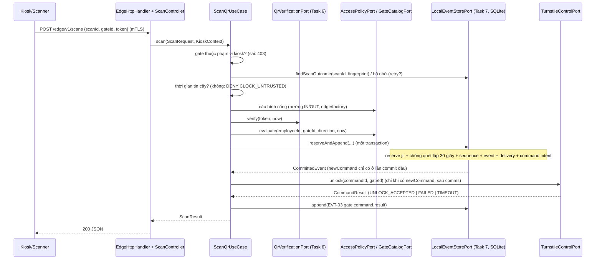

# Task 2 — Quét và vận hành cổng tại Edge: bàn giao, review và giải thích luồng

Người phụ trách: Task 2 (nhánh `task-2/gate-station`). Tài liệu này gồm: (1) cái gì đã làm và bằng chứng, (2) luồng xử lý
và giải thích từng thành phần, (3) quyết định thiết kế, (4) **các khoảng hở tìm thấy ở task khác** cần xử lý trước khi
tích hợp, (5) giới hạn và câu hỏi mở. Nguồn quy định: `TEAM.md` (Task 2), `CONTRACT-V1.md` §3, §5, §6, §10, §11,
`docs/DECISIONS.md` §3, §4, §7.

## 1. Tóm tắt trạng thái

| Hạng mục | Trạng thái |
|---|---|
| Luồng quét QR: verify → policy → reserve/lưu → mở cổng → ghi kết quả thiết bị | Đã làm, có test end-to-end với SQLite thật (Task 7) và verifier thật (Task 6) |
| Retry cùng `scanId` (idempotent), khác nội dung trả 409, không mở cổng lặp kể cả khi đua | Đã làm, có test (kể cả mô phỏng cửa sổ đua) |
| Manual override và Emergency (cần action grant), manual vẫn kiểm policy, emergency không tạo công giả | Đã làm; **bộ xác minh grant ES256 chưa có** (thuộc Task 6) nên mặc định fail closed 503 |
| Turnstile: port theo contract, mock có kịch bản lỗi/timeout/dedup 48 giờ, decorator timeout 1 giây | Đã làm, có test |
| Adapter policy đọc BootstrapCache (fail closed) | Đã làm, có test |
| API HTTP của Edge (`/scans`, `/scans/{id}`, `/overrides`, `/presence`) + cầu nối JDK HttpServer | Đã làm; **mTLS với chứng chỉ thật chưa kiểm thử** |
| KioskPage, GuardConsolePage | Đã làm; build thành công, logic có unit test; **chưa chạy thử trên trình duyệt với Edge thật** |
| p95 ≤ 2 giây (NFR-01) | **Chưa đo.** Cần k6 của Task 8 trên stack đầy đủ |

Bằng chứng chạy trên máy dev (Windows, JDK 25 biên dịch với release 21, Maven của IntelliJ):

- `mvn -pl shared-contracts,edge-gate-agent test`: **227 test, 1 thất bại, 1 bỏ qua.**
  - 66 test mới của Task 2: `GateStationFlowIT` 34, `ScanHttpIT` 15 (14 chạy, 1 tự bỏ qua), `TurnstileAdaptersTest` 10,
    `CachedAccessPolicyTest` 7. Tất cả đều xanh.
  - Test thất bại duy nhất là `JwsVerifierTest.keyStateRevokedRejectedImmediately` của **Task 6** (xem mục 5.2), không phải Task 2.
  - Test bỏ qua là `httpHandler_servesOverRealSocket_whenLoopbackIsAvailable`: JDK trên máy này không mở được kênh
    loopback NIO (`Unable to establish loopback connection`, đã thử cả ngoài sandbox). Phần logic của handler vẫn được
    kiểm thử bằng `HttpExchange` giả trong bộ nhớ.
- `npm test` (frontend): 23 test xanh (10 mới của Task 2, 13 của Task 8). `npm run build` thành công.
- **Kiểm tra độ tin cậy của test bằng đột biến:** lần đầu tôi cố tình bỏ chốt "chỉ mở khi store trả `newCommand`" thì
  toàn bộ test vẫn xanh, nghĩa là chốt đó chưa được kiểm thử. Tôi đã thêm 3 test mô phỏng cửa sổ đua
  (`raceOnSame*ScanId_*`), chạy lại đột biến thì test thất bại đúng chỗ (`expected 1 but was 2`), sau đó khôi phục code.

## 2. Bản đồ file

```
edge-gate-agent/src/main/java/vn/tmc/edge/gatestation/
  domain/            (không phụ thuộc framework/HTTP/JDBC)
    ScanRequest, OverrideRequest, KioskContext     đầu vào đã kiểm hình dạng, token/grant không lọt vào toString
    ScanResult, CommandResult, PolicyDecision      kết quả theo CONTRACT-V1 §5/§10
    GateInfo, ClockReading                         dữ liệu cấu hình cổng, thời gian + cờ tin cậy
    AccessPolicyPort, GateCatalogPort              quyền + cấu hình cổng từ cache
    TurnstileControlPort                           unlock(commandId, gateId) → CommandResult
    TrustedClockPort                               thời gian tin cậy (CLOCK_UNTRUSTED)
    ActionGrantVerificationPort                    xác minh grant (adapter thuộc Task 6)
    PresenceRegistry                               hiện diện cục bộ
    GateStationException, Uuids                    lỗi HTTP của contract, kiểm tra UUIDv4
  application/
    ScanQrUseCase            điều phối luồng quét QR
    GateOverrideUseCase      điều phối manual/emergency
    GateDecisionRecorder     cơ chế dùng chung: retry, ghi DENY (EVT-02), mở cổng + ghi kết quả (EVT-03), hiện diện
    RecentScanResults        bộ nhớ có giới hạn cho retry DENY và trạng thái lệnh cuối
    AttendancePayloads       điểm duy nhất dựng AttendancePayload (cách ly khác biệt giữa nhánh Task 3 và Task 7)
  infrastructure/
    CachedAccessPolicy       đọc BootstrapCache của Task 7 (policy + gate), fail closed
    MockTurnstileAdapter     turnstile giả có kịch bản lỗi, dedup commandId 48 giờ
    TimeBoundedTurnstile     decorator timeout 1 giây cho adapter bất kỳ
    SystemTrustedClock       đồng hồ + cờ tin cậy do monitor cấp
    InMemoryPresenceTracker  hiện diện trong bộ nhớ
    ScanController           HTTP thuần (method/path/body → status/JSON), không phụ thuộc server
    EdgeHttpHandler          cầu nối JDK HttpServer, KioskResolver, CertificateKioskResolver (mTLS → KioskContext)
    ScanWireJson             JSON nghiêm ngặt, Instant đúng 3 chữ số ms
    UnavailableActionGrantVerifier   placeholder fail closed
frontend/src/pages/KioskPage.jsx, GuardConsolePage.jsx
frontend/src/lib/gateStation.js        logic hiển thị thuần, có test
frontend/src/styles/gate-station.css
```

## 3. Luồng quét QR (UC-02/03)



Ý nghĩa từng bước và lý do thứ tự:

1. **Phạm vi kiosk (403, không phải DENY).** Kiosk chỉ được điều khiển gate trong chứng chỉ của nó. Sai là lỗi thiết bị,
   không phải quyết định nghiệp vụ.
2. **Retry trước mọi kiểm tra credential.** Cùng `scanId` + cùng nội dung trả lại đúng kết quả cũ. Khác nội dung là
   `409 IDEMPOTENCY_CONFLICT`. Làm sớm để một token đã dùng (replay) không biến lần retry hợp lệ thành DENY. Fingerprint
   là SHA-256 của `gateId + token`, không lưu token thô.
3. **Thời gian tin cậy.** Thời điểm quét quyết định công và hạn token nên không có thời gian tin cậy thì fail closed
   (`CLOCK_UNTRUSTED`).
4. **Cấu hình cổng từ cache.** Hướng vào/ra do Edge quyết, không tin scanner. Thiếu cache hoặc cache hết tin cậy là
   `CACHE_UNAVAILABLE`.
5. **Verify (Task 6)** rồi **policy**. Verify chỉ chứng minh token đúng, chưa phải "được vào". Policy kiểm tra nhân
   viên active, gate bật, có window phủ (gate, hướng, thời điểm).
6. **`reserveAndAppend` là điểm không quay đầu.** Một transaction SQLite gom: replay jti, chống quét lặp 30 giây, cấp
   sequence, ghi event + delivery, ghi command intent. Lỗi ghi → `503 STORAGE_UNAVAILABLE`, **cổng không mở**
   (test `storageFailure_doesNotUnlockAndReturns503`).
7. **Chỉ mở khi store trả `newCommand`.** `newCommand` chỉ có ở lần commit đầu của `scanId`. Retry hoặc request đến
   muộn trong cuộc đua nhận `newCommand` rỗng và không bao giờ mở lần hai.
8. **Kết quả thiết bị là event riêng (EVT-03)**, không sửa EVT-01. `ALLOW` nghĩa là *đủ điều kiện và đã lưu*; người đã
   qua cổng hay chưa thì chỉ biết qua `commandStatus`, và cả `UNLOCK_ACCEPTED` cũng mới là "thiết bị đã nhận lệnh".

Bảng quyết định kết quả:

| Tình huống | HTTP | decision | reasonCode | commandStatus | Event ghi |
|---|---|---|---|---|---|
| Hợp lệ, thiết bị nhận lệnh | 200 | ALLOW | OK | UNLOCK_ACCEPTED | EVT-01, EVT-03 |
| Hợp lệ, thiết bị từ chối | 200 | ALLOW | OK | FAILED | EVT-01, EVT-03 |
| Hợp lệ, thiết bị không phản hồi | 200 | ALLOW | OK | TIMEOUT | EVT-01, EVT-03 |
| Token sai/hết hạn/kid lạ/thu hồi | 200 | DENY | INVALID_TOKEN / TOKEN_EXPIRED / UNKNOWN_KID / REVOKED | NOT_SENT | EVT-02 |
| Ngoài quyền, cổng tắt, cache mất | 200 | DENY | OUTSIDE_POLICY / GATE_DISABLED / CACHE_UNAVAILABLE | NOT_SENT | EVT-02 |
| Dùng lại jti | 200 | DENY | REPLAY | NOT_SENT | EVT-02 |
| Quét lặp trong 30 giây | 200 | DENY | DUPLICATE_SCAN | NOT_SENT | EVT-02 |
| Đồng hồ không tin cậy | 200 | DENY | CLOCK_UNTRUSTED | NOT_SENT | EVT-02 |
| Gate ngoài phạm vi kiosk | 403 | — | DEVICE_BINDING_MISMATCH | — | không |
| Kho SQLite lỗi | 503 (retryable) | — | STORAGE_UNAVAILABLE | — | không, **không mở** |
| Cùng scanId khác nội dung | 409 | — | IDEMPOTENCY_CONFLICT | — | không |

Ví dụ: nhân viên A quét lúc 07:58:00, quét lại lúc 07:58:10 bằng token mới → lần hai bị `DUPLICATE_SCAN` (BR-03), nhưng
vẫn để lại EVT-02 làm chứng cứ. Quét lúc 07:58:31 thì được ALLOW (đúng ngưỡng 30 giây của store).

## 4. Luồng manual / emergency (UC-04)

Điều kiện chung: có **action grant** do Central cấp sau khi bảo vệ nhập lại mật khẩu (`POST /auth/action-grants`, 60 giây,
dùng một lần). Edge không tự re-auth.

1. Phạm vi kiosk (403) → retry theo `scanId` (fingerprint gồm cả `grant`, nên retry hợp lệ nhận lại kết quả cũ).
2. Thời gian tin cậy → `grantVerifier.verify(grant, now)`. Lỗi → DENY với mã của verifier (`TOKEN_EXPIRED`, …).
3. Grant khác **chứng chỉ thiết bị** (sai edge hoặc gate ngoài phạm vi kiosk) → 403. Grant khác **nội dung body**
   (action/gate/employee/lý do) → `DENY INVALID_TOKEN`.
4. **MANUAL:** cổng phải có trong cache; nhân viên phải qua `policy.evaluate` (không âm thầm bỏ qua quyền khu vực);
   ghi event công `source=MANUAL` kèm `operatorId` + `reason`, reserve jti loại `ACTION`, rồi mở cổng.
   Event MANUAL cũng tham gia chống quét lặp 30 giây.
5. **EMERGENCY:** không kiểm policy và không phụ thuộc cổng đang bật hay tắt (mục đích là thoát hiểm). Chỉ
   `commitEmergency` (command + reserve ACTION), **không tạo event công**, rồi mở cổng. Kết quả `decision=EMERGENCY`,
   `eventId=null`.
6. Grant dùng một lần: dùng lại jti là `DENY REPLAY`.

Nếu chưa có adapter xác minh grant, `UnavailableActionGrantVerifier` trả `503 DEPENDENCY_UNAVAILABLE` cho mọi override
(fail closed). Quét QR không bị ảnh hưởng.

## 5. Phụ thuộc và khoảng hở tìm thấy ở task khác (cần xử lý)

Để code Task 2 tôi dựng nhánh cục bộ `task-2/gate-station` từ `main` rồi gộp `task-6`, `task-7`, `task-8` (không có
xung đột). Task 1, 3, 5 chưa cần cho runtime Edge. **Nhánh này chứa các commit gộp của task khác; PR của Task 2 phải
rebase lại sau khi Task 6/7 vào main** (Task 2 không biên dịch được độc lập vì dùng port của hai task đó).

### 5.1 Task 7 (edge-sync): quan trọng nhất

| # | Khoảng hở | Hệ quả hiện tại | Đề nghị |
|---|---|---|---|
| G1 | `LocalEventStorePort` không có method ghi kết quả command. `local_gate_commands.status` và `local_scan_outcomes.command_status` mãi là `NOT_SENT` (chỉ recovery đổi thành `TIMEOUT`) | Sau khi khởi động lại, mọi lệnh cũ hiện `TIMEOUT` dù thiết bị đã nhận; `cleanup` chỉ xóa lệnh `UNLOCK_ACCEPTED/FAILED` nên không bao giờ xóa được | Thêm `completeCommand(commandId, status, completedAt, code)` cập nhật hai bảng nguyên tử (có thể kèm append EVT-03) |
| G2 | DENY không được lưu vào `local_scan_outcomes` (schema đã cho phép `decision='DENY'`) | Retry DENY sau khi khởi động lại bị đánh giá lại và ghi thêm EVT-02 | Lưu outcome DENY khi `append` EVT-02 của scan |
| G3 | `findScanOutcome` bắt buộc có fingerprint | `GET /scans/{scanId}` không đọc được store, chỉ trả từ bộ nhớ | Thêm bản chỉ đọc theo `scanId` |
| G4 | Không có truy vấn "lượt ALLOW gần nhất theo nhân viên" | Hiện diện chỉ trong bộ nhớ, mất khi khởi động lại | Thêm port truy vấn từ `local_scan_outcomes` |
| G5 | `SqliteAllowIT` dùng chữ ký cũ `TurnstileControlPort.unlock(String)` | **Đã sửa 3 chỗ trong nhánh này** vì Task 2 đổi port theo contract §10 | Task 7 lấy thay đổi này khi gộp |

### 5.2 Task 6 (qr-security)

- **Nhánh `task-6` hiện không biên dịch được.** `InMemoryQrKeyCache` gọi `keySet.revision()` (record chỉ có `version()`)
  và khai báo `Snapshot.EMPTY` ngoài lớp `Snapshot`. Handover của Task 6 có ghi chưa chạy `mvn`. Tôi đã sửa tối thiểu hai chỗ
  trong commit `TEMP-FIX(task-6)` để build được; **Task 6 cần tự sửa trong nhánh của mình** rồi bỏ commit này.
- `JwsVerifierTest.keyStateRevokedRejectedImmediately` thất bại: cache chỉ có một khóa REVOKED thì `hasUsableKeys()` là
  false nên verifier trả `CACHE_UNAVAILABLE` trước khi xét state khóa; test mong `REVOKED`. Cần thống nhất đúng thứ tự.
- **Cần adapter `ActionGrantVerificationPort`** (ES256, `aud=tmc-edge-action`, skew 5 giây). Task 2 đã khai báo port và
  `VerifiedGrant`; adapter thuộc Task 6 vì là mật mã.

### 5.3 Task 6 + Task 7: cache khóa/thu hồi chưa được nối (rủi ro tích hợp nghiêm trọng)

`JwsVerifier` đọc `QrKeyCachePort`/`QrRevocationCachePort` (in-memory của Task 6), nhưng `BootstrapWorker` của Task 7 chỉ ghi
vào `BootstrapCache` (SQLite) và **không có ai** nạp hai cache của Task 6. Trên thực tế, nếu wiring như hiện tại thì
verifier luôn thấy cache rỗng và **từ chối mọi lượt quét** (`CACHE_UNAVAILABLE`). Ngoài ra có hai họ kiểu trùng nhau:
`QrKeySet`/`QrKeySetEntry`/`RevocationChange` (Task 6, `String`) và `BootstrapResponse.KeySet`/`SigningKey`/`RevocationChange`
(Task 7, kiểu có enum/UUID). Test của Task 2 nạp cache của Task 6 thủ công (`GateStationFixture`) để mô phỏng phần nối này.
Đề nghị Task 6/7 chốt một trong hai: (a) `JwsVerifier` đọc trực tiếp `BootstrapCache` (khuyến nghị, một nguồn sự thật),
hoặc (b) thêm bước nạp sau mỗi `cache.apply`.

### 5.4 Task 3 (attendance)

`AttendancePayload` đang có hai hình dạng khác nhau: nhánh Task 7 dùng `String` cho ID, nhánh Task 3 dùng `UUID` kèm validation
(và `SqliteStore.requireAttendance` của Task 7 so sánh theo chuỗi). Khi gộp hai nhánh sẽ xung đột. Task 2 chỉ dựng payload ở **một**
chỗ (`AttendancePayloads`, 2 factory) nên khi hợp nhất chỉ phải sửa file đó.

### 5.5 Task 8 (platform) và Task 1

- `vite.config.js` chỉ proxy `/api`. KioskPage/GuardConsolePage gọi `/edge/v1` (hoặc `VITE_EDGE_BASE_URL`); cần thêm proxy
  hoặc cấu hình origin cho Edge.
- `httpClient.js` gọi `onUnauthorized` (xóa session) với **mọi** 401. `POST /auth/action-grants` trả 401 khi nhập sai mật
  khẩu re-auth, nên sai mật khẩu sẽ **đăng xuất bảo vệ**. Cần ngoại lệ cho đường dẫn này (Task 8) hoặc dùng mã khác (Task 1).
- `EdgeApplication` (Task 7) chưa có HTTP server; wiring mẫu ở mục 7. Cần HttpsServer với client auth bắt buộc.
- Task 1 cần cung cấp `/auth/action-grants` (Bearer + `{password, action, edgeId, gateId, employeeId?, reason}`).
- Task 5 cần `GET /gates` đúng shape (`id, name, edgeId, direction, enabled`) cho ô chọn cổng ở Guard console; nếu chưa có,
  trang cho nhập mã cổng/Edge thủ công.

## 6. Quyết định thiết kế (và lý do)

| Quyết định | Lý do |
|---|---|
| Tách `GateDecisionRecorder` khỏi hai use case | Retry, ghi DENY, mở cổng + EVT-03 giống nhau cho QR/manual/emergency; use case chỉ còn điều phối luồng (SRP) |
| Mọi thứ ngoài domain đi qua port (verifier, policy, store, turnstile, clock, grant) | Dependency Inversion: thay mock/thật không sửa use case; test dùng thành phần thật của task khác ở hai đầu |
| `TimeBoundedTurnstile` là decorator, không nhét timeout vào từng adapter | Một chỗ duy nhất đảm bảo "scan không chờ vô hạn"; adapter thật chỉ lo giao thức (OCP/LSP) |
| Mock turnstile giữ đúng hợp đồng (dedup, không ném exception, có kịch bản FAIL/TIMEOUT) | Contract §5 cấm mock chỉ luôn thành công; test bám được các nhánh lỗi thật |
| Lỗi thiết bị không ném exception: là `FAILED`/`TIMEOUT` | ALLOW đã commit; lỗi thiết bị không được làm mất kết quả đã lưu hay gây retry mù |
| DENY và lỗi HTTP tách bạch | Contract §2: DENY là kết quả nghiệp vụ 200; FE hiển thị khác nhau |
| `ScanController` thuần (không phụ thuộc server) | Kiểm thử HTTP không cần mở cổng; máy dev hiện không mở được loopback NIO |
| `RecentScanResults` có giới hạn 20.000 mục và 48 giờ | Lấp G1/G2 tạm thời mà không phình bộ nhớ; mất khi khởi động lại là chấp nhận được (an toàn: hiện TIMEOUT, không tự mở lại) |
| Không log token, grant, message của driver; chỉ log tên lớp lỗi | CONTRACT-V1 §2: không log secret hoặc toàn bộ JWS |

Lựa chọn nơi contract chưa quy định (cần nhóm xác nhận):

1. Grant khác nội dung body → `DENY INVALID_TOKEN`; grant khác chứng chỉ thiết bị → 403 `DEVICE_BINDING_MISMATCH`.
2. MANUAL tại cổng đang tắt → `DENY GATE_DISABLED`; EMERGENCY bỏ qua trạng thái bật/tắt.
3. `/presence` thêm field `trackedSince` (chỉ thêm, tương thích ngược) vì dữ liệu mất khi khởi động lại.
4. Request thiếu trường nullable được chấp nhận (Jackson không phân biệt vắng với `null` cho `String`), nới so với "phải gửi null".
5. Hiện diện chỉ tính khi thiết bị trả `UNLOCK_ACCEPTED`.

## 7. Wiring mẫu (cho Task 7/8 khi dựng `EdgeApplication`)

```java
var clock = Clock.systemUTC();
var store = SqliteStore.openProvisioned(dbFile, clock, identity);
var cache = store.bootstrapCache(identity);
var policy = new CachedAccessPolicy(cache);                          // vừa là AccessPolicyPort vừa là GateCatalogPort
var turnstile = new TimeBoundedTurnstile(realOrMockTurnstile, clock); // timeout 1 giây
var recorder = new GateDecisionRecorder(store, turnstile, connectivity::mode,
        new RecentScanResults(clock), new InMemoryPresenceTracker(clock), clock);
var trustedClock = new SystemTrustedClock(clock, ntpHealthy::getAsBoolean);
var scan = new ScanQrUseCase(verifier, policy, policy, store, trustedClock, recorder);
var override = new GateOverrideUseCase(grantVerifier, policy, policy, store, trustedClock, recorder);
var controller = new ScanController(scan, override, recorder, presence);
httpsServer.createContext("/edge/v1/", new EdgeHttpHandler(controller, new CertificateKioskResolver(fingerprintToKiosk)));
```

`httpsServer` phải dùng client auth bắt buộc; `fingerprintToKiosk` (SHA-256 chứng chỉ → `KioskContext`) cấp qua provisioning.

## 8. Giới hạn, rủi ro và câu hỏi mở

- **EVT-02 cho mọi DENY** (đúng contract) nghĩa là người ngoài quét mã rác liên tục sẽ làm đầy SQLite. Chưa có rate limit
  hay gom nhóm. Cần quyết định: giới hạn theo kiosk/khoảng thời gian, hay chỉ ghi EVT-02 khi token đã xác minh chữ ký.
- **mTLS chưa kiểm thử với chứng chỉ thật** (`CertificateKioskResolver`); chỉ có logic ánh xạ.
- **Chưa đo hiệu năng.** Ước tính chỉ là phép tính; con số 2 giây phải đo bằng k6 của Task 8 sau khi nối đủ.
- **Frontend chưa chạy trên trình duyệt thật** với Edge/Central thật; mới kiểm tra build và logic thuần.
- **`TimeBoundedTurnstile` chưa chịu tải** (mỗi lệnh một virtual thread); chưa có benchmark.
- Hiện diện mất khi khởi động lại và chỉ phản ánh Edge hiện tại (xem G4).
- Cách đánh giá "đồng hồ tin cậy" (NFR-12) chưa có monitor thật; `SystemTrustedClock` mặc định coi là tin cậy.
- Chưa cập nhật `docs/REQUIREMENTS.md` (theo quy ước chỉ cập nhật khi có bằng chứng đã nêu ở mục 1).

## 9. Chạy lại

```bash
# Backend (JDK 21+, Maven). Trên máy dev dùng Maven đi kèm IntelliJ.
mvn -pl shared-contracts,edge-gate-agent test
# Chỉ phần Task 2
mvn -pl shared-contracts,edge-gate-agent test -Dtest='GateStationFlowIT,ScanHttpIT,TurnstileAdaptersTest,CachedAccessPolicyTest' -Dsurefire.failIfNoSpecifiedTests=false

# Frontend
cd frontend && npm ci && npm test && npm run build
```

Kết quả kỳ vọng hiện tại: backend chỉ còn 1 thất bại là test của Task 6 (mục 5.2). Test socket thật sẽ chạy trên máy mở
được loopback NIO; trên máy này nó tự bỏ qua.
